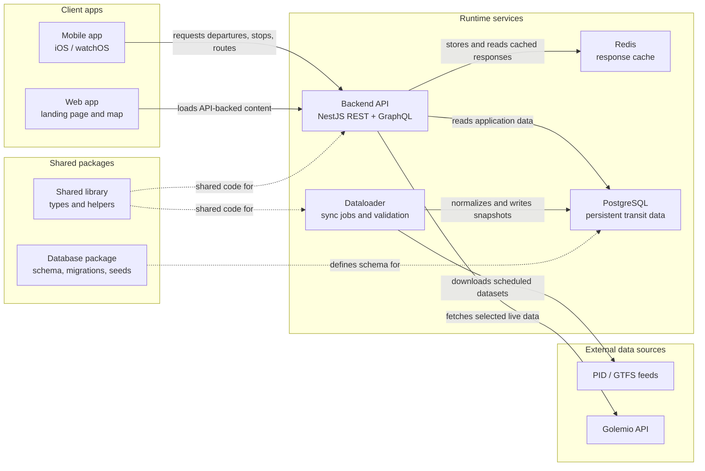

<a href="https://apps.apple.com/cz/app/metro-now/id6504659402?platform=appleWatch">
  
</a>
<a href="https://play.google.com/store/apps/details?id=dev.metronow.android&hl=en">
  
</a>

<br/>

# Metro now

<div align="center">
  <a href="https://api.metronow.dev">
    <b>REST API</b>
  </a>
  •
  <a href="https://api.metronow.dev/graphql">
    <b>GraphQL</b>
  </a>
  •
  <a href="https://status.uptime-monitor.io/6712f0b0063af5950476d77c">
    <b>Status</b>
  </a>
</div>


Transit monorepo with a NestJS backend, Next.js web app, background dataloader, and native iOS/watchOS app. Uses pnpm workspaces and Turborepo.

## Architecture



## Workspace layout

```text
apps/
  backend/      NestJS API (REST + GraphQL)
  database/     schema, migrations, seeds
  dataloader/   background sync worker
  mobile/       iOS / watchOS app (Xcode)
  web/          Next.js website
lib/
  shared/       shared TypeScript package
```

## Development environment (recommended)

Install [Nix and devenv 2.4.0](https://devenv.sh/getting-started/) and
[direnv](https://direnv.net/docs/installation.html). Linux and macOS are supported;
the native iOS/watchOS app still requires Apple's Xcode on macOS.

Add the direnv hook to your shell configuration once (for zsh, `~/.zshrc`):

```bash
eval "$(direnv hook zsh)"
```

For bash, use `eval "$(direnv hook bash)"` in `~/.bashrc`. Restart the shell,
then from the repository root:

```bash
direnv allow
metro-setup          # pnpm install --frozen-lockfile
cp apps/backend/.env.local.example apps/backend/.env.local
# Set GOLEMIO_API_KEY in apps/backend/.env.local for live API requests.
devenv up           # PostgreSQL + Redis; keep running in this terminal
```

In another terminal in this directory:

```bash
metro-db-setup       # migrations + seed data (replaces local transit records)
pnpm dev
```

The shell supplies Node.js 22, Corepack (using `packageManager` in `package.json`),
PostgreSQL 16, Redis, and command-line tools. Entering the directory activates the
shell; it does not install JavaScript dependencies, start services, migrate, or
seed automatically. Without direnv, use `devenv shell`, then the same commands.

Services bind only to `127.0.0.1`, with PostgreSQL at port 5432 and Redis at 6379.
Devenv allocates another port if one is occupied and exports the actual values in
`DB_PORT`, `DATABASE_URL`, and `REDIS_PORT`. Shell variables take precedence over
the backend example env file. Do not start the Docker services alongside devenv
for the same development session. Database and Redis state live under `.devenv/`
and are local to the checkout; stop services before removing that state to reset it.

### Backend E2E tests and GitHub Actions

```bash
devenv test
```

This starts PostgreSQL and Redis, waits for readiness, installs locked JavaScript
dependencies, migrates and seeds a test database, runs the existing backend E2E
suites, and stops services even when tests fail. Tests use `metro-now-test` and
prefer ports 15432/16379, separate from development. Test seeding replaces test
transit records. A non-secret placeholder satisfies the Golemio configuration
validation; these suites query local data and do not test upstream authentication.

Devenv supports [GitHub Actions](https://devenv.sh/integrations/github-actions/).
The existing workflows retain their current setup. To adopt the same environment
for `backend-e2e`, replace that job's service containers, Node/pnpm setup, env-file
creation, migrations, seeds, and test steps with this sequence after checkout:

```yaml
- uses: cachix/install-nix-action@v31
- uses: cachix/cachix-action@v16
  with:
    name: devenv
- run: nix profile add github:cachix/devenv/v2.4.0
- run: devenv test
```

The public binary cache needs no write token. The test configuration supplies all
local service settings and a placeholder API key, so these backend suites do not
need the Golemio secret. Xcode jobs and the Docker bundle integration test should
keep their existing setup: devenv does not replace those toolchains or checks.

`devenv.yaml` pins the package and module sources, and the committed
`devenv.lock` records their resolved dependencies. Use `devenv update` to refresh
the lock, review the diff, and rerun `devenv test`. To upgrade the pinned sources or devenv CLI, update
`devenv.yaml` and any CI install command together.

### Manual setup

If you do not use devenv, install Node.js 20 (as used by the existing non-devenv
CI jobs), pnpm 10 via Corepack, and Docker for PostgreSQL + Redis:

```bash
corepack enable
pnpm install --frozen-lockfile
cp apps/backend/.env.local.example apps/backend/.env.local
# Edit apps/backend/.env.local with your local values and Docker ports below.
```

## Development

```bash
pnpm docker:up:dev   # start PostgreSQL and Redis
pnpm dev             # run all dev servers
pnpm xcode           # open mobile app in Xcode
```

Run a single app:

```bash
pnpm turbo run dev --filter=@metro-now/backend
pnpm turbo run dev --filter=@metro-now/web
pnpm turbo run dev --filter=@metro-now/dataloader
```

## Common commands

```bash
pnpm build           # build all packages
pnpm test:unit       # run unit tests
pnpm lint            # lint all packages
pnpm types:check     # type-check all packages
pnpm typegen         # generate GraphQL types
pnpm app:format      # format Swift code
```

Scope any Turbo task with `--filter`:

```bash
pnpm turbo run test:e2e --filter=@metro-now/backend
pnpm turbo run migrate:deploy --filter=@metro-now/database
pnpm turbo run seed --filter=@metro-now/database
```

## Docker

```bash
pnpm docker:up       # start full stack (builds containers)
pnpm docker:down     # stop and remove volumes
```

Default ports:

| Service        | Address                  |
| -------------- | ------------------------ |
| Web            | http://localhost:3000    |
| Backend        | http://localhost:3001    |
| PostgreSQL     | localhost:5532           |
| Redis          | localhost:6479           |
| Redis Stack UI | http://localhost:8101    |

## License

[Mozilla Public License 2.0](LICENSE.md)
